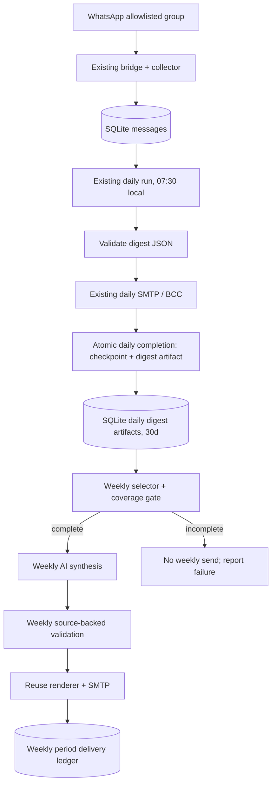

# v2.5.0 — Weekly Technical Digest Architecture

**Status:** Implemented in isolated `feature/v2.5.0-weekly-digest` worktree; production rollout pending
**Repository:** `egori4/whatsapp_summarizer`
**Baseline reviewed:** `main` at `11e434b` / v2.4.0, on `m920q` (2026-11-04)
**Companion:** [V2_5_WEEKLY_DIGEST_IMPLEMENTATION_PLAN.md](V2_5_WEEKLY_DIGEST_IMPLEMENTATION_PLAN.md)

## 1. Decision in one paragraph

Add an **optional weekly roll-up** to each existing daily workflow. Store its **validated daily digest JSON** in local SQLite when a real daily run completes, then run a **separate weekly model call** over those persisted digest items. Reuse the existing Hermes/Ollama provider selection, validation principles, HTML/text renderer, SMTP/BCC delivery, systemd timer generation and per-workflow locking. Do **not** reread seven days of WhatsApp raw messages, introduce another group workflow or change the collector/checkpoint semantics. Weekly is an independent downstream report; daily remains the source of truth.

## 2. Verified v2.4 starting point

- `whatsapp_digest/collector.py` and `transport.py`: one configured, allowlisted WhatsApp bridge and collector; SQLite message capture.
- `whatsapp_digest/runner.py`: one checkpoint per workflow; selects unprocessed `change_seq` records; can add 48h historical context; validates a structured model response; sends email; advances the checkpoint **only following successful delivery or a no-material/no-message outcome**.
- `whatsapp_digest/database.py`: `messages`, `workflow_state`, `runs` tables; **no persisted successful digest body**. Existing `runs` stores run metadata, not JSON output.
- `whatsapp_digest/config.py`: a WhatsApp `group_jid` may appear only once among workflows. A second ordinary workflow for the same group would fail validation.
- `whatsapp_digest/systemd.py`: daily/weekly/monthly `OnCalendar` supported already, but each configured workflow currently has just one schedule and one generated service/timer.
- `whatsapp_digest/model/hermes.py` and `model/ollama.py`: Hermes worker (or native structured-output Ollama when selected); existing prompt guard `MAX_PROMPT_CHARS=160_000`. Model output is limited to `MAX_OUTPUT_CHARS=65_536`.
- `whatsapp_digest/validation.py`: current source IDs and participant names must match actual selected raw messages; the current validator **cannot be reused unchanged** to validate weekly citations against saved daily items.
- `whatsapp_digest/renderer.py` and `delivery/email.py`: reusable section-based text/HTML rendering, SMTP recipients/CC/BCC, failure notification; raw attachment can be omitted by passing `raw_text=None`.
- Current on-host Global PS schedule: **07:30 America/Toronto** (the `tests` workflow is scheduled at 08:00). Current raw-message retention: **7 days**.

## 3. Goals, boundaries, and non-goals

### Goals

1. A self-contained weekly technical briefing: important learnings, issues/resolutions, genuinely open questions and explicit follow-ups.
2. Merge recurring threads across days; retain the **latest evidence-backed state**, distinguish proposed changes from tested fixes, and remove duplicate coverage.
3. Every weekly item traces to one or more **persisted daily digest items**; no claim is allowed solely because a model thinks it is plausible.
4. Preserve existing daily operation, sender/recipient/BCC controls and checkpoint integrity.
5. Clear coverage, safe retries, no duplicate sends under normal repeated invocation, and bounded local retention.
6. Feature disabled by default for existing configurations; zero effect on their schedules until enabled.

### Non-goals for v2.5

- No second WhatsApp collector, conversation bot, new third-party database, workflow engine or Gmail retrieval.
- No direct weekly reread of raw WhatsApp content; no historical WhatsApp backfill.
- No automatic external web fact-checking or inferred action ownership.
- No cross-group/global weekly report, topic knowledge graph, vector database, chunked multi-pass summarization or arbitrary reporting frequencies.
- No exact-once guarantee across SMTP acceptance and local database commit (SMTP has no idempotency contract).

## 4. Data flow



**Important:** On the no-pending/no-usable/no-material path there is no daily email, but the successful daily cycle still creates an **empty daily artifact** together with checkpoint completion. This preserves evidence that a daily reporting cycle completed without material content. Raw retention continues to operate independently.

## 5. Reporting period and coverage rules

### Period definition

- One weekly report per local **Monday**. Default weekly timer: **Monday 08:30 America/Toronto**, after the existing 07:30 daily job.
- The immutable report key is `(workflow_id, week_start_local_date)` where `week_start_local_date` is the previous Monday's ISO date. `week_end_local_date` is the current Monday's ISO date.
- Select canonical successful daily artifacts completed within **(previous Monday 08:30, current Monday 08:30]**, using the workflow's timezone and `zoneinfo`. Use **local Monday boundaries first**, then convert to UTC; do not compute DST weeks as `7 * 24` hours.
- In normal operation that selects the **seven Tue-through-Mon daily runs**, whose incremental WhatsApp coverage is approximately previous Monday 07:30 through current Monday 07:30. Do **not** label this as exact midnight-to-midnight WhatsApp coverage. Show the selected daily run dates and min/max underlying message timestamps when useful.
- This is a *daily-run consolidation interval*, not a query against message occurrence time. Late collection or an unusually late daily run can shift the effective message window; surface such cases rather than silently asserting perfect calendar coverage.

### Canonical daily artifacts only

- Persist and select only successful **checkpoint-driven, real** daily completions (`last=None`, `since=None`, `dry_run=False`). Include manual *normal checkpoint-driven* catch-up runs as well as scheduled runs.
- Exclude `--dry-run`, explicit `--last/--since` replays and failed runs. An initial explicit-window run establishes the checkpoint but does not masquerade as a canonical daily digest.
- Persist successful empty cycles as `{"sections": []}`. One day may have more than one canonical run; include all and merge items, relying on checkpoint lineage rather than assuming exactly seven rows.

### Coverage gate — fail closed

Before generating or sending a weekly report:

1. Require an **anchor**: the most recent canonical successful daily artifact on or before the previous Monday 08:30 boundary. If missing (e.g., v2.5 enabled mid-week), report `insufficient-history`; do not fabricate a full week.
2. Order selected artifacts by checkpoint progression. Each artifact's `checkpoint_before` must equal the preceding artifact's `checkpoint_after`, starting from the anchor. This avoids unnoticed omitted/overlapping canonical windows.
3. Require a canonical successful daily artifact for the **current Monday morning**, completed by the weekly 08:30 cutoff (or a clearly valid later manual recovery for the same period, if introduced in a later release). If absent, report `daily-not-complete`; do not send a partial report.
4. If selected artifacts are empty, the anchor is missing, a day ended without recovery, input JSON is invalid, or an artifact was pruned, **do not send** a purportedly complete weekly summary.
5. Missing intermediate *calendar-day runs* are acceptable **if** a subsequent canonical run caught up all checkpoints before the cutoff. Completeness is about covered checkpoint lineage, not a count of seven emails.
6. A week with only successful empty daily artifacts **is complete**. Send an honest short "No material technical updates" weekly email rather than silently skipping the week.

**Known limitation:** checkpoint continuity verifies processing of **collected** messages, not uptime/completeness of the upstream WhatsApp bridge. This release must not claim universal WhatsApp delivery completeness.

**Late/catch-up limitation:** if the Monday daily digest completes *after* the immutable 08:30 weekly cutoff, automatic weekly generation fails closed. A delayed report must be explicitly reviewed; do not silently pull Tuesday material into the previous week. Automatic backfill across late period boundaries is deferred.

## 6. Persistence and lifecycle

Keep the existing SQLite database. The following DDL reflects the implemented SQLite contract and preserves these semantics.

```sql
CREATE TABLE IF NOT EXISTS daily_digest_artifacts (
  run_id TEXT PRIMARY KEY REFERENCES runs(run_id),
  workflow_id TEXT NOT NULL,
  completed_at TEXT NOT NULL,       -- ISO-8601 UTC
  checkpoint_before INTEGER NOT NULL,
  checkpoint_after INTEGER NOT NULL,
  outcome TEXT NOT NULL,            -- delivered | success-no-material | success-no-pending | success-no-usable
  window_start TEXT,
  window_end TEXT,
  digest_json TEXT NOT NULL,        -- VALIDATED JSON; {"sections":[]} permitted
  schema_version INTEGER NOT NULL DEFAULT 1
);
CREATE INDEX IF NOT EXISTS idx_daily_artifact_period
  ON daily_digest_artifacts(workflow_id, completed_at);

CREATE TABLE IF NOT EXISTS weekly_reports (
  workflow_id TEXT NOT NULL,
  week_start_local_date TEXT NOT NULL,   -- previous Monday, YYYY-MM-DD
  week_end_local_date TEXT NOT NULL,     -- current Monday, YYYY-MM-DD
  run_id TEXT NOT NULL REFERENCES runs(run_id),
  delivered_at TEXT NOT NULL,
  input_run_ids_json TEXT NOT NULL,      -- source artifact manifest
  digest_json TEXT,                     -- nullable after artifact retention purge
  PRIMARY KEY(workflow_id, week_start_local_date)
);
```

- Extend `DigestDatabase` rather than creating another persistence layer. `CREATE TABLE IF NOT EXISTS` works with the existing startup schema initialization; no migration framework is needed.
- Store normalized, already-validated **daily structured JSON**. Do **not** save prompts, untrusted raw WhatsApp text, secrets or model scratch output in these artifacts. Daily items already contain `source_ids` and contacts, so treat artifacts as sensitive.
- On daily success, insert the artifact and update `workflow_state`/`runs` **in one SQLite transaction**, **before** the processed-raw purge. Refactor the existing `complete_success_and_checkpoint()` paths to avoid committing a checkpoint without its artifact. Preserve the current send-before-checkpoint order for emailed digests.
- A duplicate finalization for one run ID must be harmless. Do not create an artifact when the daily email send failed or when freshness/validation failed.
- Retain full daily `digest_json` for **30 days** (new `retention.digest_days`, default 30 if weekly enabled). Retain weekly JSON for the same period; afterwards null weekly `digest_json`/source manifest as appropriate, but **keep the tiny delivered-period ledger**, or an equivalent non-sensitive key, so an old week cannot be resent simply because content expired.
- Never purge daily artifacts that are required to synthesize an eligible but not-yet-completed week within the configured 30-day window. After 30 days, a late report is explicitly unavailable without a separate backfill design.
- When a new feature is not enabled, old v2.4 configs must load without new required fields. Fresh deployment stores artifacts only for workflows that opt into weekly summary, to minimize additional sensitive-data retention.

### Delivery ledger semantics

- Use the same per-workflow lock as the daily runner (`workflow_lock`) to serialize daily and weekly runs; a dedicated locking service is unnecessary.
- Check `weekly_reports` by the immutable period key before invoking the model or SMTP. If already delivered, return `already-delivered`.
- Insert the delivered-period record only **after SMTP acceptance**, within a transaction; never mark sent before attempting delivery. Retain the generated `digest_json` if accepted and committed.
- A crash between SMTP acceptance and the SQLite ledger commit may lead to one repeat email on retry; **at-least-once**, not exactly-once. Expose the stable week key in subject/headers and document this known narrow ambiguity.
- A failed or incomplete weekly attempt **never** advances the WhatsApp/daily checkpoint or prevents subsequent daily runs.

## 7. Weekly model input, output and evidence

### Input cards

Each persisted daily item becomes one bounded, immutable evidence card, not a WhatsApp message. For example:

```json
{
  "source_id": "daily:20261103T123000Z-global-ps-abcd1234:technical_updates:0",
  "digest_date": "2026-11-03",
  "daily_run_id": "20261103T123000Z-global-ps-abcd1234",
  "section_id": "technical_updates",
  "title": "Example title",
  "summary": "Example technical conclusion",
  "details": [],
  "actions": [],
  "questions": [],
  "reported_by": ["Engineer A"],
  "contributors": [],
  "references": [],
  "original_message_ids": ["original-whatsapp-message-id"]
}
```

- The above values are **illustrative only**. Generate the card ID deterministically from daily run ID + section ID + item index; preserve traceability to the original WhatsApp message IDs without fetching deleted raw text.
- Include complete validated daily content, date, references and contributors. The weekly model can merge several daily cards into one weekly topic.
- Apply the same untrusted-source and no-tools/no-memory model isolation as daily summarization. Daily content must not override system instructions, send email, run commands or alter recipients.
- Use the normal model configured on the parent workflow. Extend/factor the existing model-call transport minimally to accept a weekly prompt and weekly source schema; **do not create a second generic agent engine**. Keep Hermes and explicitly configured native `ollama-local` consistent: no silent provider fallback. Apply each provider's existing preflight limits.
- If the full set of cards exceeds the existing model input budget, **fail explicitly** with diagnostics. Do not silently drop daily cards or introduce automatic hierarchical chunking in v2.5.

### Structured weekly output

Reuse the existing `sections -> items` output shape and renderer with these fixed weekly sections:

1. `key_learnings` — reusable, confirmed technical facts and limitations.
2. `issues_resolutions` — issues, diagnosis, candidate/verified fixes, latest status.
3. `open_questions_followups` — material still-open questions and **explicit** assigned/requested actions.

Weekly item fields remain `title`, `summary`, `details`, `actions`, `questions`, `reported_by`, `contributors`, `references`, `source_ids`. Each `source_ids` entry names an **input daily evidence card**, not a WhatsApp message ID. The email should display readable daily digest dates as evidence, rather than opaque IDs; store the ID-to-daily-run mapping in the local report.

### Weekly-specific validation (essential)

- Enforce the existing structural field/length/section bounds; each item must cite at least one valid daily card ID in the selected period.
- Contacts are restricted to names in the **cited cards** (not arbitrary names from elsewhere in the week).
- HTTP(S) references/URLs must already occur in the **cited cards'** validated references/content; an invented URL is rejected.
- A card from another workflow, a dry-run, an expired artifact, or outside the selected interval cannot be cited.
- Reject new sections, malformed arrays, fabricated evidence IDs and oversized output.
- Rules in the weekly prompt: latest explicitly supported status supersedes older information; silence does not prove resolution; lab validation is not production resolution; inferred tasks are prohibited; one topic should not appear in multiple sections.
- Model text still needs human-oriented QA; structural validation cannot mathematically prove that every technical inference is correct.

## 8. Scheduling, configuration and interfaces

Example additive configuration (existing fields omitted):

```yaml
retention:
  processed_raw_days: 7
  log_days: 30
  digest_days: 30

workflows:
  - id: global-ps
    # Existing daily schedule, group JID, model, sections and delivery stay as-is.
    weekly_summary:
      enabled: true
      schedule:
        type: weekly
        days: [mon]
        at: "08:30"
```

- Default absent `weekly_summary` to disabled. Scope weekly to existing parent workflow; never create a duplicate group JID workflow.
- v2.5 supports **exactly one weekly Monday slot** per enabled parent workflow. Configuration validation should reject other days/multiple days, or implement a clearly documented single weekday if future requirements change. Keep v2.5 narrow.
- Inherit the existing timezone, configured model, sender, To/Cc/Bcc and SMTP secret. Weekly **never** attaches raw messages (always `raw_text=None`).
- Weekly subject by default: `[TechTeam Weekly] Week ending {week_end} — {workflow_name}`; limit substitution to trusted config/period fields. Show the actual period/coverage metadata in the rendered body.
- Generate `whatsapp-digest-<workflow_id>-weekly.service/.timer`; continue using systemd user units, `Persistent=true` and `AccuracySec=1min`. The separate timer executes a distinct CLI command (`digest weekly <workflow_id> --scheduled`).
- On `schedule install`, manage both daily and enabled weekly units as one desired set; existing stale-timer cleanup must **not** accidentally delete valid weekly timers. On disable/remove, stop only the corresponding weekly timer; the daily timer stays unchanged.
- Intended CLI: `digest weekly global-ps --dry-run`, `digest weekly global-ps --period YYYY-MM-DD --dry-run`, and `digest weekly global-ps` (manual real send with existing completeness/duplicate checks). `--period` is the **previous Monday local date**; reject invalid weekday or future window. Normal scheduler computes this automatically.
- Extend `digest status` / `digest schedule status` to show weekly enablement, last delivered week, pending readiness or failure, and next timer.

## 9. Failures and recovery

| Scenario | Required behavior |
|---|---|
| Daily SMTP/model/validation failure | No new successful artifact; old daily checkpoint semantics preserved. |
| Successful daily run with zero messages | Store an empty artifact and advance checkpoint normally. |
| Weekly input missing baseline, last Monday daily, or chain continuity | No model call/email; record reason, notify according to existing failure policy. |
| Duplicate manual/scheduled weekly invocation | Lock + delivered-week key prevent a second normal email. |
| Weekly model, schema validation, or SMTP failure | Record failed weekly run; do not mark week delivered; daily checkpoint never changes; manual retry possible. |
| Weekly digest has no items but complete coverage | Send concise "No material technical updates" report and mark delivered. |
| Weekly output too large | Fail visibly; never silently omit input cards. |
| DST switch | Construct local period boundaries with `ZoneInfo`; compare UTC instants; test 167/169-hour local weeks. |
| 30-day artifact retention exceeded | Explain that the report cannot be reconstructed; do not silently fetch raw WhatsApp. |
| SMTP accepted but ledger write failed | Potential duplicate on retry (known non-atomic cross-system edge); same stable period key aids investigation. |
| Collector/bridge outage | Weekly cannot detect uncollected WhatsApp history; existing transport monitoring remains authoritative. |

## 10. Security and observability

- Preserve WhatsApp allowlist, read-only collector, source-as-untrusted rules, no tools/memory and fixed SMTP recipient config.
- Local SQLite digest text is sensitive: maintain owner-only filesystem permissions (and do not write report JSON to routine logs); take care with debug output, artifacts, backups and attachments.
- Log/report counts, source run IDs, period key, covered checkpoint range, model/provider/reasoning, statuses, elapsed time and failure stage, **not** participant text or raw message bodies.
- Daily and weekly emails are separate products; weekly generation must not modify daily `workflow_state` or existing daily email templates.

## 11. Acceptance criteria (architectural DoD)

- [ ] Existing v2.4 config, daily systemd unit, daily email, checkpoints and BCC behavior work unmodified when weekly is absent/disabled.
- [ ] Weekly receives only persisted, successfully validated **daily** outputs and never reprocesses WhatsApp source messages.
- [ ] Checkpoint completion + artifact persistence are atomic; no undelivered/failed/dry-run artifacts masquerade as canonical input.
- [ ] Period boundaries, first-week baseline, no-pending days and catch-up checkpoint continuity are correctly handled.
- [ ] Weekly technical claims are grounded in permitted daily cards, with accurate issue state, contacts, and references.
- [ ] One weekly period creates at most one normally recorded delivery, with a documented SMTP commit ambiguity.
- [ ] Incomplete or corrupted source coverage fails closed; no partial report is labeled complete.
- [ ] Only one additional weekly systemd timer/service is installed when enabled; disabled workflows are untouched.
- [ ] Retention of summarized content and persistent non-sensitive delivery ledger are tested.
- [ ] No actual SMTP messages or production-data changes occur in automated tests.

**Implementation and executable test matrix:** see [V2_5_WEEKLY_DIGEST_IMPLEMENTATION_PLAN.md](V2_5_WEEKLY_DIGEST_IMPLEMENTATION_PLAN.md).
